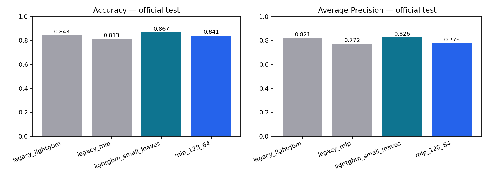

# Adult Income — Classical ML and PyTorch

[](https://colab.research.google.com/github/VietAnh1803/HCMUT_ML_AdultCensusIncome_Pipeline/blob/main/notebooks/adult_income_improved.ipynb)

HCMUT Machine Learning coursework, followed by a measured evaluation and training
improvement in October 2026. The extension adds a separate validation partition,
official UCI test data, deterministic PyTorch training, and an explicit selection lock.
AI assisted implementation and documentation; all scores come from executed code.

[Improved notebook](notebooks/adult_income_improved.ipynb) ·
[Executed notebook](reports/improved/executed_adult_income_improved.ipynb) ·
[Experiment report](reports/IMPROVEMENT_REPORT.md) ·
[Measured results](reports/improved/metrics.json)

## What was improved

The original notebook chose configurations using test scores. The extension selects
models and thresholds using validation only, then grades selected models and two
predeclared controls on a separate official test. Exact feature duplicates and
train/test overlaps are removed. Preprocessing is fitted on training only.

On the same **16,249-row test**, the new LightGBM pipeline reached **86.73% accuracy**
and **0.9276 ROC-AUC**, compared with **84.29% accuracy** for the matched-protocol
legacy recipe. The selected PyTorch MLP reached **84.09% accuracy** and **0.9103
ROC-AUC**, compared with **81.30%** for its legacy recipe.

The MLP removes SMOTE plus weighted-loss double balancing, uses AdamW and
validation-AP early stopping, and restores its best checkpoint. Three fixed seeds
produced **84.09–84.50% accuracy**. LightGBM remains the stronger model here.
Accuracy improvements include validation-selected thresholds; AP gains are modest.
The report includes paired bootstrap intervals and the original protocol's limits.



## Reproduce

Python 3.12 and CPU were used for the recorded run. No GPU or account token is needed.

```bash
git clone https://github.com/VietAnh1803/HCMUT_ML_AdultCensusIncome_Pipeline.git
cd HCMUT_ML_AdultCensusIncome_Pipeline
python -m pip install -r requirements-improved.txt
python -m unittest discover -s tests -v
python src/adult_benchmark.py
python tools/build_delivery.py
```

The benchmark downloads the public UCI archive into an ignored local cache.
The walkthrough notebook explicitly reuses the recorded run by default. Set
`REUSE_RECORDED_RUN = False` to train again; install dependencies first. All five
walkthrough code cells were executed successfully, and all five protocol tests passed.

## Source and evidence

- `src/adult_benchmark.py`: six classical candidates, three MLP configurations,
  validation selection, checkpoint restoration and separate final evaluation.
- `tests/test_protocol.py`: label normalization, invalid labels, duplicate detection,
  threshold selection, and preprocessing isolation.
- `reports/improved/`: metrics, data and split hashes, frozen choices, training curves,
  three-seed DL results, paired uncertainty estimates and the executed notebook.
- `notebooks/tabular_data_pipeline.ipynb` and `README-coursework.md`: original
  coursework, retained for context. Historical scores use a different protocol.

## Dataset and limits

Becker, B. & Kohavi, R. (1996). [Adult, UCI Machine Learning Repository](https://archive.ics.uci.edu/dataset/2/adult).
DOI: 10.24432/C5XW20. License: CC BY 4.0. The extension uses the official training
and test files, with **26,028 training**, **6,508 validation**, and **16,249 test** rows
after removing duplicate features and overlap.

This is a historical census benchmark. One validation split and three neural-network
seeds do not establish performance on current populations. Row bootstrap assumes
independent records; the data provides no person IDs to verify that assumption.
Raw data, prediction rows and local model binaries are excluded from this release.
