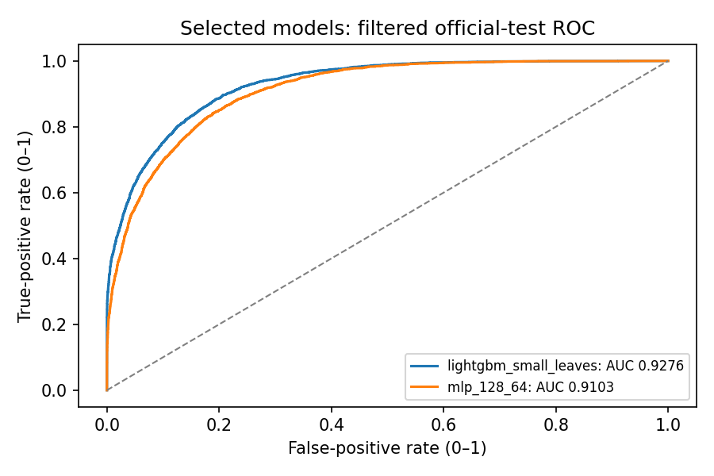

# Adult Income: classical ML, PyTorch and local evaluation

[](https://github.com/VietAnh1803/HCMUT_ML_AdultCensusIncome_Pipeline/actions/workflows/tests.yml)

This project compares tabular classifiers on UCI Adult and examines how data
preparation, validation and decision thresholds affect their reported results.
It began as HCMUT ML coursework. An October 2026 extension added controlled
experiments; a later audit added data-integrity checks and a small submission
scorer. AI assisted implementation and documentation. Results come from executed
CPU runs, not estimates. This is a personal project, not a Project Eris submission.

[Verified results](docs/verified_results.md) · [Walkthrough](notebooks/adult_income_improved.ipynb) ·
[Local scoring task](docs/local_challenge.md) · [Original coursework](README-coursework.md)

## Dataset

[Adult, UCI ML Repository](https://archive.ics.uci.edu/dataset/2/adult),
Becker and Kohavi (1996), DOI 10.24432/C5XW20, CC BY 4.0. The data was extracted
from the 1994 census. Its 14 features describe demographic and employment records;
the binary target is annual income above $50,000. This historical sample is for
learning and evaluation, not a validated basis for decisions about people.

Official files have **32,561 training** and **16,281 test** rows. The loader checks
the archive SHA-256, 15-column raw schema, labels and numerical values. It trims
categories, normalizes test labels with trailing periods and reads `?` as missing.
Missing categories use `Missing`; numerical imputation and scaling fit on train only.

The recorded split policy retains the first exact raw feature tuple, then splits
official training 80/20 with stratification and seed 42. It removes test feature
matches with official training, yielding **26,028 train / 6,508 validation /
16,249 test** records. Training has 25 extra feature duplicates versus 24 extra
labeled observations; test has 6 versus 5. Each has one conflicting-label feature
group, resolved by file order. There are 26 test feature matches with training.
The raw cross-file join has 28 matching pairs (25 same-label and 3 different-label
pairs); pairs can repeat a feature tuple. Equal features do not prove duplicate people. We preserve this policy for
comparability and report its tradeoff; the results are not on the unfiltered
official test. See the integrity counts and hashes in the verified-results document.

## Methodology and models

Imputation, StandardScaler and dense OneHotEncoder are fitted on training only.
Unknown categories are ignored. The classical models use sklearn/imblearn
pipelines; resampling remains training-only in the two legacy controls.

- **Dummy prior** exposes the majority-class baseline and is excluded from selection.
- **Logistic regression** provides a simple linear baseline.
- **Calibrated linear SVM and random forest** provide linear/margin and nonlinear comparisons.
- **LightGBM** has two bounded candidate configurations; the legacy control keeps
  SMOTE and class balancing. Estimator counts are fixed; no LightGBM early stopping is used.
- **PyTorch MLP** compares 64/32 and 128/64 ReLU networks. Training uses BCE,
  AdamW, batch size 256, up to 40 epochs, validation-AP patience 7 and restored
  best checkpoints. The legacy MLP keeps SMOTE, weighted CE, BatchNorm and 12 epochs.

There are ten validation configurations including the dummy and controls.
Validation **average precision (AP)** selects one non-control classical model and
one MLP. Validation positive-class F1 selects their classification thresholds.
Controls/dummy use 0.5. The selection lock is saved before final-test labels are
parsed. Dummy and logistic baselines are predeclared additional test comparisons.
Exact parameters, seeds, selected epochs and package versions are saved in JSON.

## Fitting checks and automated tests

**50 automated tests pass**, counted as separately discovered test methods, not
inflated by subtests. They cover data/schema boundaries, feature overlap,
train-only preprocessing, known scorer outputs, CLI failures, deterministic MLP
training, early-stopping patience/minimum delta and actual checkpoint weights.
See [the case list](docs/test_coverage.md) and
[`test_results.json`](reports/verification/test_results.json) for execution evidence.
The [GitHub Actions workflow](.github/workflows/tests.yml) installs the pinned
dependencies with CPU PyTorch and runs the same suite on Python 3.12/Linux. It
checks that all 50 cases pass and reports the count in the job summary. Tests use
small fixtures; CI does not download the Adult dataset or rerun the full benchmark.

The modern MLPs use dropout 0.10/0.15 and AdamW weight decay 0.01. LightGBM
constrains leaves, minimum child samples and L2 regularization. Training and
validation AP/log-loss are recorded for every candidate. In the unchanged full
rerun, selected LightGBM train/validation AP is **0.8607/0.8432** and selected
MLP AP is **0.8031/0.8006**. The seed-42 MLP stops at epoch 15 and restores epoch 8.
Both beat the validation dummy/logistic baselines; the MLP still trails LightGBM.
These controls mitigate and monitor overfitting. They do **not** prove that
overfitting or underfitting is eliminated. See
[measured fitting diagnostics](docs/fitting_diagnostics.md), including all
candidate scores, seed traces and remaining limitations.

## Results

Full unchanged and revised CPU runs reproduced the previous headline metrics.
The engineering audit did **not** improve accuracy over the October 11 extension.
All rows below refer to the same filtered 16,249-record official test.

| Model | Accuracy | AP | ROC-AUC | Positive F1 |
| --- | ---: | ---: | ---: | ---: |
| Dummy prior | 0.7637 | 0.2363 | 0.5000 | 0.0000 |
| Logistic regression | 0.8295 | 0.7630 | 0.9055 | 0.6854 |
| Legacy LightGBM control | 0.8429 | 0.8213 | 0.9254 | 0.7154 |
| Selected LightGBM | 0.8673 | 0.8261 | 0.9276 | 0.7222 |
| Legacy MLP control | 0.8130 | 0.7719 | 0.9089 | 0.6822 |
| Selected PyTorch MLP, seed 42 | 0.8409 | 0.7762 | 0.9103 | 0.6936 |

The selected MLP's three fixed seeds produce **84.09–84.50% accuracy**, with
mean **84.284%** and sample standard deviation **0.207 percentage points**.
LightGBM remains stronger here. Matched-control accuracy differences combine
model/training changes and validation-selected thresholds; AP gains are modest.
Precision, recall, thresholds, class counts, confusion matrices, seed results
and paired bootstrap intervals are available in the recorded outputs.



[Confusion counts](reports/improved/confusion.png) ·
[MLP loss and validation AP](reports/improved/training.png) ·
[Complete metrics](reports/improved/metrics.json)

## Reproduce

Tested with Python 3.12 on CPU; no GPU or token is needed. From the repository root:

```bash
python -m pip install -r requirements-improved.txt
python -m unittest discover -s tests -v
python tools/run_tests.py  # same suite, with a per-case JSON record
python src/adult_benchmark.py --output .cache/verified-run --cache .cache/adult
python tools/build_delivery.py --input .cache/verified-run
```

The run downloads the official archive only when missing and rejects a checksum
change. It fits the entire frozen experiment, including three MLP seeds. The
delivery command copies completed artifacts into `reports/improved`, creates
plots/bootstrap outputs and executes the walkthrough. The notebook explicitly
reads recorded results by default; set `REUSE_RECORDED_RUN = False` to retrain.
The delivery tool requires predictions from a completed run; those CSVs are
ignored and are not bundled as public data. The dependency versions used for
plotting and notebook execution are also pinned.

The audit additionally used `--baseline .cache/audit-baseline/metrics.json` for
before/after verification. That baseline run was executed against unchanged
source; the recorded numeric snapshot is in `reports/verification/pre_change_metrics.json`.

## Local scoring demonstration

The later component defines a probability-prediction task, a logistic reference
and a strict ID-matched evaluator. Primary score is AP; invalid IDs, schemas,
missing rows and invalid probabilities are rejected with CLI exit code 2.
Evaluation features contain no target column. Labels are stored separately but
remain public and recoverable. The demo uses the original validation partition,
does not load `adult.test`, and provides no hidden-test security.

```bash
python src/local_evaluation.py prepare
python src/local_evaluation.py reference --train .cache/local-evaluation/train.csv --features .cache/local-evaluation/evaluation_features.csv --output .cache/local-evaluation/reference_predictions.csv
python src/local_evaluation.py score --labels .cache/local-evaluation/evaluation_labels.csv --predictions .cache/local-evaluation/reference_predictions.csv --output .cache/local-evaluation/reference_score.json
```

Reference AP is **0.782419 on validation**, distinct from its 0.762987 official-test
AP. See the [problem and scoring contract](docs/local_challenge.md) and
[recorded local score](reports/verification/local_reference_score.json).

## Structure

```text
src/
  adult_benchmark.py                 # data, preprocessing, training and shared metrics
  local_evaluation.py                # prepare, reference and score CLI
tests/
  test_protocol.py                  # schema, labels, splits and preprocessing
  test_evaluation.py                # ID joins, invalid submissions and known scores
  test_fitting_and_integration.py   # stopping/restoration, data boundaries and CLI
tools/
  build_delivery.py                 # report/bootstrap/notebook entry point
  evidence.py                       # recorded-results plots and verification notes
  run_tests.py                      # run all cases and write per-case outcomes
docs/
  audit_before_changes.md
  verified_results.md
  local_challenge.md
  test_coverage.md
  fitting_diagnostics.md
notebooks/
  tabular_data_pipeline.ipynb        # original coursework, retained
  adult_income_improved.ipynb        # later script-based walkthrough
reports/
  improved/                         # metrics, locks, logs, plots, executed walkthrough
  verification/                     # audit comparison and local evaluator evidence
```

Legacy coursework files are retained; generated models, raw data and predictions
stay out of Git. There are no training orchestration services or invented deployments.

## Limitations

The original notebook selected configurations using test scores. The extension's
official-test scores have also already been observed. This audit freezes the
existing experiment and verifies it; it cannot turn the public test into a
pristine holdout. One validation split and three seeds do not establish broad
generalization. Feature deduplication alters observation weighting and resolves
two label conflicts by file order. No person IDs establish independence; the
row-bootstrap intervals assume it. Demographic features and historical sampling
also require care when interpreting accuracy or fairness.

## References

- [UCI Adult data and CC BY 4.0 license](https://archive.ics.uci.edu/dataset/2/adult)
- [scikit-learn model evaluation](https://scikit-learn.org/stable/modules/model_evaluation.html)
- [PyTorch reproducibility notes](https://docs.pytorch.org/docs/stable/notes/randomness.html)
- [LightGBM sklearn API](https://lightgbm.readthedocs.io/en/stable/pythonapi/lightgbm.LGBMClassifier.html)
