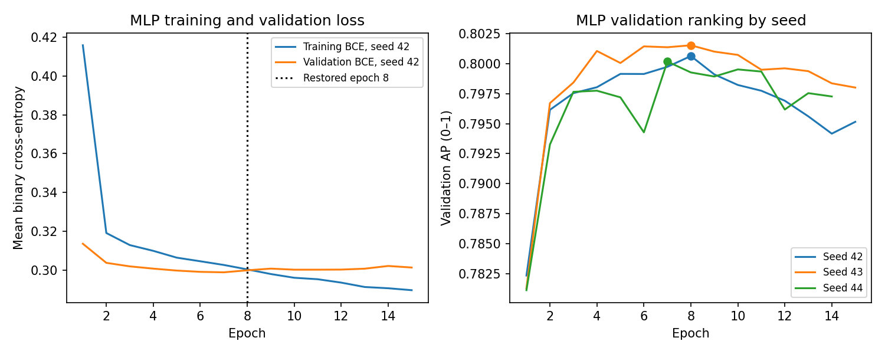

# Fitting diagnostics

Measured run UTC: `2026-10-12T07:53:58.423419+00:00`. Configurations, splits and selection rules are unchanged.

## What is controlled

- Fit preprocessing on training only; group identical raw features before the stratified split. The local reference also rejects train/evaluation feature matches with different IDs.
- Modern MLPs use dropout 0.10/0.15 and AdamW weight decay 0.01. Validation AP controls early stopping (patience 7, minimum improvement 1e-5, maximum 40 epochs). Restore the best checkpoint, even when the epoch budget is reached.
- LightGBM candidates bound leaves (15/31), minimum child samples (40/60) and L2 regularization (1/2); estimator counts remain fixed. No LightGBM early stopping is claimed.
- Compare training and validation AP/log-loss with dummy and logistic baselines and both MLP capacities. These are diagnostics of insufficient fit, not a proof that the optimum architecture or regularization has been found.

## Train–validation measurements

Training scores below are in-sample predictions on the original unresampled training partition. Validation scores use the held-out validation partition. For MLPs, both are measured in eval mode at the returned checkpoint, with dropout disabled. AP gaps are train minus validation; loss gaps are validation minus train. A larger positive gap can indicate overfitting; no universal cutoff establishes it.

| Model | Train AP | Validation AP | AP gap | Train log-loss | Validation log-loss |
| --- | ---: | ---: | ---: | ---: | ---: |
| dummy_prior | 0.2409 | 0.2409 | -0.0000 | 0.5521 | 0.5522 |
| logistic | 0.7675 | 0.7824 | -0.0149 | 0.3179 | 0.3114 |
| linear_svm | 0.7680 | 0.7827 | -0.0147 | 0.3187 | 0.3122 |
| random_forest | 0.8287 | 0.8085 | +0.0203 | 0.2901 | 0.3078 |
| legacy_lightgbm | 0.8684 | 0.8411 | +0.0273 | 0.2769 | 0.3079 |
| lightgbm_regularized | 0.8735 | 0.8432 | +0.0303 | 0.2394 | 0.2687 |
| lightgbm_small_leaves | 0.8607 | 0.8432 | +0.0175 | 0.2518 | 0.2695 |
| legacy_mlp | 0.8126 | 0.7958 | +0.0168 | 0.3374 | 0.3656 |
| mlp_64_32 | 0.8070 | 0.7998 | +0.0072 | 0.2899 | 0.2989 |
| mlp_128_64 | 0.8031 | 0.8006 | +0.0025 | 0.2951 | 0.2999 |

## Checkpoint behavior on the full dataset

| MLP | Epochs run | Selected epoch | Stop reason | Best-checkpoint restored |
| --- | ---: | ---: | --- | --- |
| legacy_mlp | 12 | 12 | legacy_fixed_budget | False |
| mlp_64_32 | 24 | 17 | patience_exhausted | True |
| mlp_128_64 | 15 | 8 | patience_exhausted | True |
| mlp_128_64_seed_43 | 15 | 8 | patience_exhausted | True |
| mlp_128_64_seed_44 | 14 | 7 | patience_exhausted | True |

The legacy MLP intentionally retains its final fixed-budget epoch as a historical control; it does not use the modern stopping rule. Unit tests use controlled validation scores and compare actual state_dict tensors to verify patience reset, minimum delta and restoration rather than trusting a trace flag.

The training-loss curve averages minibatch losses while weights change during each epoch. The table above uses full-partition log-loss at a single checkpoint; these are different measurements. Validation AP need not peak at the lowest validation loss.

## Interpretation and remaining uncertainty

The selected LightGBM has train AP 0.8607 and validation AP 0.8432 (gap +0.0175). The selected MLP has train AP 0.8031 and validation AP 0.8006 (gap +0.0025). Report the measured gaps rather than claiming overfitting has been eliminated.

Validation AP is 0.2409 for the prior-only dummy and 0.7824 for logistic regression. The selected models beat these simple baselines on validation, which argues against a trivial majority-only fit. The MLP still trails LightGBM on validation; that alone does not distinguish insufficient capacity, optimization, representation or regularization. Underfitting is not ruled out.

Only one validation split and three MLP seeds have been evaluated. No learning curve over dataset sizes or nested cross-validation is claimed. The official test was previously observed; diagnostics in this update do not use it to adjust models. A future tuning experiment should predeclare its search on training/validation and use a genuinely new evaluation set for independent confirmation.

See [test coverage](test_coverage.md) for the 50 separately discovered automated cases. Passing software checks verifies implementation behavior, not absence of statistical overfitting or underfitting.
